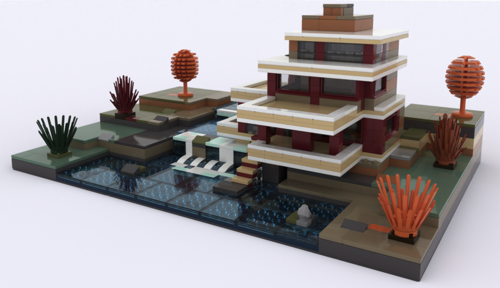
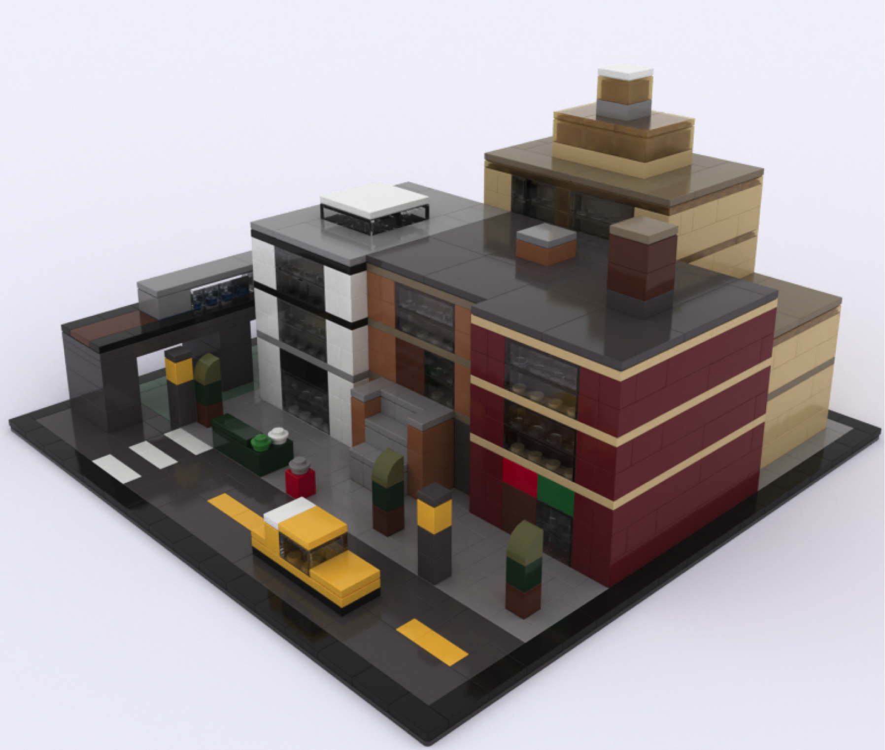
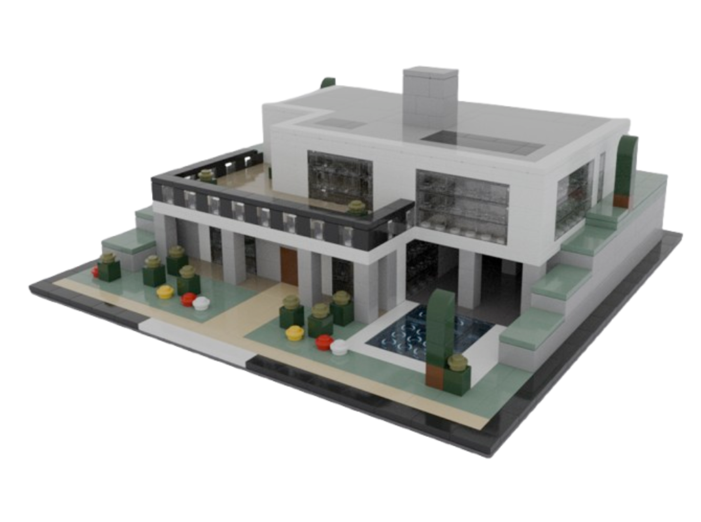
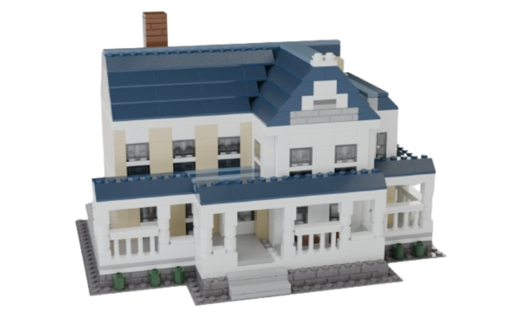
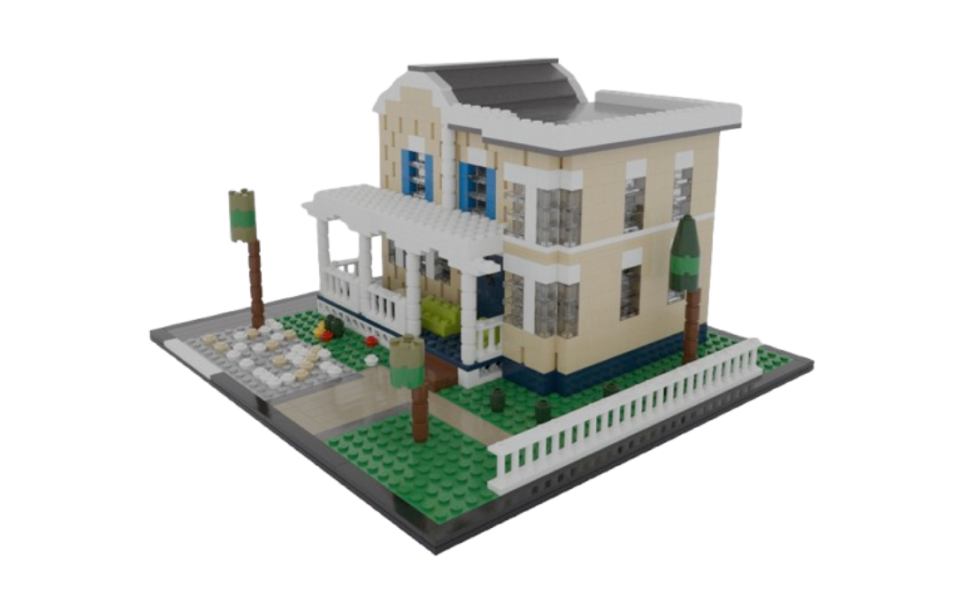

# Example gallery

Selected digital models from BrickSmith design sessions, rendered in Blender.
These examples show the output format and range of subjects.

## Fallingwater study

[Open the 988-piece LDraw model](fallingwater-gorge.ldr). The scene is inspired
by Fallingwater at Bear Run.

## New York City neighborhood

## Modernist villa

## Queen Anne Victorian

## Porch house

